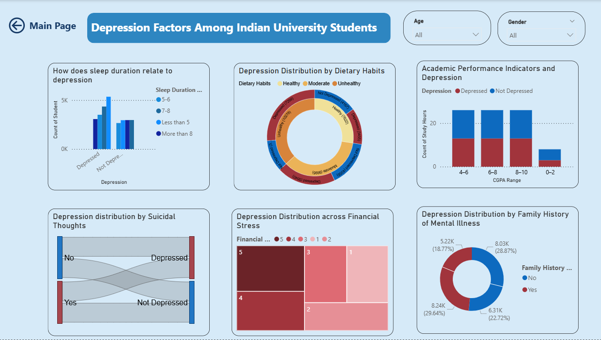
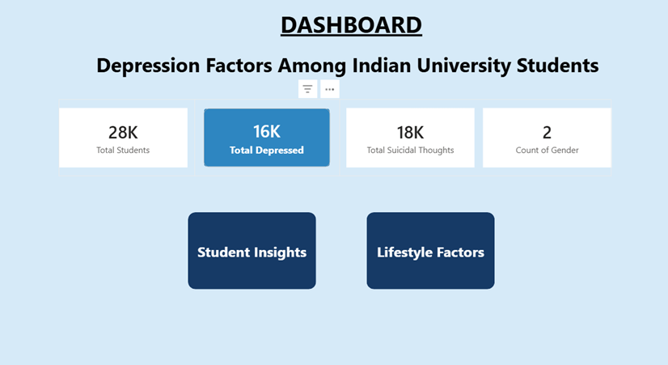

# Student Depression Analysis Dashboard

An interactive data analytics and visualization project exploring the prevalence and factors associated with depression among university students in India.

The project transforms survey data into an interactive Power BI dashboard to explore relationships between depression and academic, lifestyle, financial, and personal factors.

> **Academic Group Project** — developed as part of the Bachelor of Computer Science (Honours) programme at Universiti Teknologi MARA (UiTM).

## Project Overview

University students may experience various academic, financial, lifestyle, and personal pressures that are associated with mental well-being.

This project analyzes the **Student Depression Dataset** from Kaggle and presents the findings through an interactive Power BI dashboard.

The analysis focuses on variables including:

- Academic pressure and CGPA
- Study hours
- Sleep duration
- Dietary habits
- Financial stress
- Suicidal thoughts
- Family history of mental illness
- Demographic factors such as age and gender

The purpose of the dashboard is to make patterns within the dataset easier to explore and understand through interactive data visualization.

## Dashboard Preview

### Main Dashboard



### Main Menu



## Tools & Technologies

- **Microsoft Power BI** — data analysis, interactive visualization, and dashboard development
- **Microsoft Excel** — initial dataset inspection and formatting
- **WEKA** — data cleaning and preparation
- **CSV** — source dataset
- **CRISP-DM** — project methodology framework

## Methodology

The project follows the **CRISP-DM (Cross-Industry Standard Process for Data Mining)** framework to provide a structured approach to the analysis.

### 1. Business Understanding

Define the problem and identify the need to understand factors associated with depression among university students.

### 2. Data Understanding

Explore the dataset and examine its academic, demographic, lifestyle, financial, and psychological attributes.

### 3. Data Preparation

Inspect and format the dataset using Microsoft Excel, followed by data cleaning and preparation using WEKA.

### 4. Exploratory Analysis

Use Power BI to explore relationships and distributions across the dataset.

### 5. Visualization & Dashboard Development

Develop an interactive dashboard using multiple visualization techniques and filters to communicate the findings clearly.

## Dashboard Features

The dashboard includes interactive analysis of:

- Depression and sleep duration
- Depression distribution by dietary habits
- Academic performance indicators and depression
- Depression and suicidal thoughts
- Financial stress distribution
- Family history of mental illness
- Age filtering
- Gender filtering

Visualizations include stacked charts, donut charts, treemaps, Sankey-style flow visualization, and other comparative visuals.

## Repository Structure

```text
student-depression-powerbi/
|
+-- dashboard/
|   +-- student_depression_dashboard.pbix
|
+-- data/
|   +-- student_depression_dataset.csv
|
+-- screenshots/
|   +-- dashboard_overview.png
|   +-- main_menu.png
|
+-- README.md
```

## Dataset

The project uses the **Student Depression Dataset**, a publicly available dataset sourced from Kaggle.

The dataset contains academic, demographic, lifestyle, financial, and psychological attributes related to university students in India.

The dataset is included in the `data/` directory for reproducibility and portfolio demonstration purposes.

## How to Explore the Dashboard

1. Download or clone this repository.
2. Install Microsoft Power BI Desktop.
3. Open:

```text
dashboard/student_depression_dashboard.pbix
```

4. Use the dashboard filters and interactive visualizations to explore the dataset.

## Project Scope & Limitations

The analysis is based on self-reported survey data and does not provide clinical or medical verification of depression.

The findings therefore represent patterns and associations within the provided dataset and should not be interpreted as medical diagnoses or causal conclusions.

The analysis is also specific to the dataset and population represented and should not be generalized to all university students.

## Skills Demonstrated

This project demonstrates practical experience in:

- Data analysis
- Data cleaning and preparation
- Exploratory data analysis
- Power BI dashboard development
- Interactive data visualization
- Data storytelling
- Dashboard design
- CRISP-DM methodology
- Communicating analytical findings

## Academic Project

This dashboard was developed as an **academic group project**. This repository is maintained as part of my personal portfolio to demonstrate the data analytics and visualization skills applied during the project.

---

**Muhammad Amirul Rosli**  
Bachelor of Computer Science (Honours)  
Universiti Teknologi MARA (UiTM)